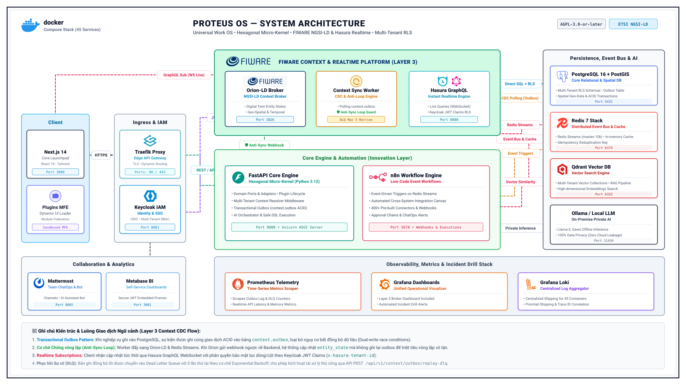

<div align="center">

  

  <h1>⚡ Proteus OS</h1>

  <p><strong>Nền tảng Hệ điều hành Quản trị Đa năng Thế hệ mới cho Tổ chức</strong></p>
  <p><em>Universal Work Operating System • Hexagonal Micro-Kernel • FIWARE NGSI-LD &amp; Hasura Realtime Context • Multi-Tenant RLS</em></p>

  <br>

  [](./LICENSE)
  [](https://www.python.org/)
  [](./core-engine/backend)
  [](./core-engine/frontend)
  [](./deploy)
  [](https://www.postgresql.org/)
  [](https://hasura.io/)
  [](https://www.keycloak.org/)

  <br>

  [](https://github.com/CuongKenn/ICTU-Proteus-OS/stargazers)
  [](https://github.com/CuongKenn/ICTU-Proteus-OS/issues)
  [](https://github.com/CuongKenn/ICTU-Proteus-OS/network/members)
  [](https://github.com/CuongKenn/ICTU-Proteus-OS/commits/main)

</div>

---

## 📑 Mục lục
- [1. Giới thiệu Tổng quan](#-1-giới-thiệu-tổng-quan)
- [2. Sơ đồ Kiến trúc Hệ thống](#-2-sơ-đồ-kiến-trúc-hệ-thống)
- [3. Phân tầng Kiến trúc Chi tiết](#-3-phân-tầng-kiến-trúc-chi-tiết)
- [4. Tính năng Nổi bật](#-4-tính-năng-nổi-bật)
- [5. Ngăn xếp Công nghệ](#-5-ngăn-xếp-công-nghệ)
- [6. Hướng dẫn Triển khai & Khởi động Nhanh](#-6-hướng-dẫn-triển-khai--khởi-động-nhanh)
- [7. Kiểm thử & Đảm bảo Chất lượng](#-7-kiểm-thử--đảm-bảo-chất-lượng)
- [8. Hệ thống Tài liệu Kỹ thuật](#-8-hệ-thống-tài-liệu-kỹ-thuật)
- [9. Quy chuẩn Đóng góp & Bản quyền](#-9-quy-chuẩn-đóng-góp--bản-quyền)

---

## 🌟 1. Giới thiệu Tổng quan

Trong hầu hết các tổ chức hiện nay (từ Doanh nghiệp, Trường học cho tới Bệnh viện), dữ liệu và quy trình tác nghiệp thường bị phân mảnh thành nhiều **"ốc đảo thông tin" (Data Silos)** rời rạc: phân hệ nhân sự, tài chính, giao tiếp nội bộ, quy trình tự động hóa và báo cáo kinh doanh hoạt động độc lập và thiếu tính liên kết.

**Proteus OS** được thiết kế như một **Hệ điều hành Quản trị Đa năng (Universal Work OS)** mã nguồn mở:
- **Kiến trúc Lõi (Core Engine):** Xây dựng theo mô hình **Hexagonal Architecture (Ports & Adapters)** kết hợp vi nhân (Micro-Kernel), đảm bảo tính module hóa cao, dễ kiểm thử và độc lập với các thư viện bên ngoài.
- **Mô hình Dữ liệu Ngữ cảnh Thực thể (Digital Twin):** Tích hợp tiêu chuẩn mở **FIWARE NGSI-LD** và **Hasura Realtime GraphQL**, cho phép biểu diễn, truy vấn và đăng ký theo dõi trạng thái thực thể của tổ chức theo thời gian thực.
- **Hệ sinh thái Plugin Độc lập (Plugin Marketplace):** Cho phép cài đặt, nâng cấp, cấu hình và gỡ bỏ động các tính năng nghiệp vụ mà không làm gián đoạn hệ thống lõi.
- **Bảo mật & Cô lập Tuyệt đối (Multi-Tenancy):** Phân quyền dựa trên vai trò (RBAC) kết hợp kỹ thuật **Row-Level Security (RLS)** trên PostgreSQL và ánh xạ quyền hạn qua JSON Web Tokens (JWT) của Keycloak.

---

## 🏗️ 2. Sơ đồ Kiến trúc Hệ thống

Toàn bộ hệ thống Proteus OS được module hóa thành các tầng chức năng rõ ràng, kết nối thông qua các chuẩn giao tiếp mở:

<div align="center">
  
  <p><em>Sơ đồ Kiến trúc Tổng thể &amp; Luồng Dữ liệu Proteus OS (Official Open Source Vector Diagram)</em></p>
</div>

---

## 🔍 3. Phân tầng Kiến trúc Chi tiết

Hệ thống được chia thành 6 phân vùng kiến trúc chính:

### 1. Ingress, Edge Gateway & Bảo mật
* **Traefik Proxy:** Cổng API Gateway tiếp nhận toàn bộ traffic bên ngoài, tự động cấp phát và gia hạn chứng chỉ TLS (Let's Encrypt), định tuyến theo quy tắc PathPrefix (`/api`, `/auth`, `/chat`, `/graphql`), cân bằng tải và kiểm tra trạng thái dịch vụ (Healthchecks).
* **Keycloak IAM:** Máy chủ quản lý định danh và truy cập tập trung theo chuẩn OpenID Connect (OIDC) và OAuth 2.0. Quản lý realms đa khách hàng, hỗ trợ Single Sign-On (SSO) và tự động nhúng claims ngữ cảnh (`x-hasura-tenant-id`, `x-hasura-default-role`) vào JWT.

### 2. Giao diện Người dùng & Tương tác (Presentation Layer)
* **Next.js 14 Launchpad (Core UI):** Giao diện bảng điều khiển quản trị trung tâm, phát triển bằng React 18, Server Components, Zustand và TailwindCSS theo phong cách Glassmorphism trực quan.
* **Plugin Micro-Frontend (MFE Gateway):** Cổng nạp giao diện động của từng plugin từ thư mục `plugins/<code>/frontend`, đảm bảo tính cô lập và tải theo nhu cầu (On-demand loading).
* **Mattermost Team Chat:** Kênh trao đổi thông tin, tương tác thời gian thực và ChatOps Bot giữa nhân sự và AI Agent.
* **Metabase OSS BI:** Phân tích dữ liệu tự phục vụ và nhúng các báo cáo trực quan an toàn qua IFrame có chữ ký số JWT.

### 3. Lõi Hệ điều hành (Core Engine - Innovation Layer)
* **FastAPI Core Engine (Python 3.12):** Lõi xử lý trung tâm theo kiến trúc Lục giác (Hexagonal Architecture):
  * *Domain & Use Cases:* Thực hiện toàn bộ logic nghiệp vụ cốt lõi và các kịch bản đồng bộ thực thể.
  * *Plugin Lifecycle Manager:* Quản lý vòng đời plugin (Cài đặt, Di trú schema, Bật, Tắt, Gỡ bỏ) thông qua manifest chuẩn.
  * *Transactional Outbox Pattern:* Ghi nhận mọi biến động thực thể vào bảng `context.outbox` trong cùng giao dịch ACID với dữ liệu nghiệp vụ, loại trừ triệt để tình trạng bất đồng bộ dữ liệu (Dual-write race conditions).
  * *AI Orchestrator & DX-DSL:* Điều phối Agent thực thi công việc với cơ chế kiểm tra an toàn (Guardrails) và pipeline RAG (Retrieval-Augmented Generation).
* **n8n Workflow Automation:** Nền tảng tự động hóa quy trình nghiệp vụ low-code dựa trên sự kiện, liên kết linh hoạt với Redis Streams và webhook của bên thứ ba.

### 4. Context Broker & Realtime (Lớp 3)
* **FIWARE Orion-LD:** Context Broker đạt chuẩn quốc tế ETSI NGSI-LD, quản lý đồ thị thực thể số (Digital Twin), xử lý các truy vấn không gian (Geo-spatial) và thông báo thay đổi (Subscriptions).
* **Hasura GraphQL Engine:** Cung cấp API GraphQL hiệu năng cao, hỗ trợ truy vấn trực tiếp (Live Queries) qua WebSocket, thực thi phân quyền dòng/cột theo JWT claim từ Keycloak.
* **Context Sync Worker & Anti-Loop:**
  * Worker nền đọc các bản ghi từ `context.outbox`, chuyển hóa thành cấu trúc NGSI-LD và cập nhật sang Orion-LD.
  * Đẩy các sự kiện ngữ cảnh sang Redis Streams.
  * **Cơ chế Chống vòng lặp đồng bộ (Anti-Sync Loop):** Khi nhận webhook thông báo ngược từ Orion-LD, cập nhật trực tiếp `entity_state` mà không ghi lại vào `context.outbox`, triệt tiêu hoàn toàn vòng lặp vô tận.
  * Tích hợp Dead Letter Queue (DLQ) và cơ chế tái xử lý (`POST /api/v1/context/outbox/replay-dlq`).

### 5. Dữ liệu, Sự kiện & Suy luận AI (Persistence & AI)
* **PostgreSQL 16 + PostGIS:** Cơ sở dữ liệu quan hệ lõi hỗ trợ phần mở rộng không gian, quản lý phân vùng dữ liệu và kích hoạt chính sách Row-Level Security (RLS) để cô lập dữ liệu từng tenant.
* **Redis 7 Stack:** Message Queue và Event Bus phân tán qua Redis Streams (`maxlen=10000`), lưu trữ cache tốc độ cao và đảm bảo tính Idempotency.
* **Qdrant Vector DB:** Lưu trữ vector embedding độ chính xác cao, phục vụ tìm kiếm ngữ nghĩa và tra cứu tài liệu thông minh (RAG).
* **Ollama (On-Premise AI):** Máy chủ suy luận các mô hình ngôn ngữ lớn (Llama-3, Qwen) hoàn toàn cục bộ, bảo đảm dữ liệu tổ chức không bị gửi ra ngoài đám mây.

### 6. Giám sát Vận hành (Observability Stack)
* **Prometheus:** Thu thập và lưu trữ số liệu hiệu năng (API latency, throughput, Outbox lag, số lượng DLQ).
* **Grafana:** Bảng điều khiển trực quan hóa thời gian thực tình trạng toàn bộ hệ thống và Context Broker.
* **Grafana Loki & Promtail:** Thu thập và tập trung hóa nhật ký ghi vết (Logs) từ toàn bộ containers, phục vụ điều tra sự cố.

---

## ✨ 4. Tính năng Nổi bật

| Tính năng | Mô tả chi tiết |
|:---|:---|
| **Đa khách hàng (Multi-Tenancy)** | Cô lập dữ liệu triệt để bằng PostgreSQL Row-Level Security (RLS) kết hợp middleware trích xuất Tenant-ID tự động từ JWT Token. |
| **Đồ thị Thực thể Số (Digital Twin)** | Quản lý trạng thái thực thể của tổ chức theo chuẩn FIWARE NGSI-LD và cập nhật realtime tới client qua Hasura GraphQL Subscriptions. |
| **Giao dịch Tin cậy (Outbox CDC)** | Cơ chế Transactional Outbox đảm bảo tính nhất quán cuối cùng (Eventual Consistency), chống mất mát dữ liệu khi có sự cố mạng. |
| **Chống vòng lặp Đồng bộ** | Thuật toán Anti-Sync Loop phân tách luồng ghi và luồng webhook, ngăn ngừa tải ảo và bão lặp sự kiện giữa Backend và Broker. |
| **Cơ chế Tự phục hồi & DLQ** | Tự động chuyển các bản ghi đồng bộ lỗi vào Dead Letter Queue với chính sách Exponential Backoff và cung cấp API Replay linh hoạt. |
| **Chợ Ứng dụng Module (Plugins)** | Cấu trúc mở cho phép cài đặt và tích hợp nhanh các phân hệ: HRM, CRM, Tài chính, Quản lý kho, Quản lý trường học... |
| **Trí tuệ Nhân tạo Nội bộ (Local AI)** | Tích hợp RAG với Qdrant và mô hình chạy on-premise qua Ollama, bảo vệ tối đa quyền riêng tư và dữ liệu nhạy cảm. |

---

## 🛠️ 5. Ngăn xếp Công nghệ

| Phân hệ | Công nghệ | Phiên bản / Chuẩn | Vai trò |
|:---|:---|:---|:---|
| **Core Backend** | FastAPI, Python | 3.12, Uvicorn | Lõi vi nhân Hexagonal, REST API, Plugin Lifecycle |
| **Core Frontend** | Next.js, React, TailwindCSS | Next 14, React 18 | Giao diện Launchpad, BFF, App Store |
| **Context Broker** | FIWARE Orion-LD | ETSI NGSI-LD | Quản lý trạng thái thực thể số & không gian |
| **Realtime GraphQL** | Hasura GraphQL Engine | v2.43 | Live Queries, WebSocket subscriptions, RLS permissions |
| **Identity & SSO** | Keycloak | 25.x, OIDC / OAuth2 | Đăng nhập tập trung, cấp phát JWT và quản lý vai trò |
| **Cơ sở dữ liệu** | PostgreSQL + PostGIS | 16-3.4 | Dữ liệu quan hệ, Schema RLS, Không gian địa lý |
| **Event Bus & Cache**| Redis Stack | 7.x, Streams | Pub/Sub, Outbox Event Stream, In-memory Caching |
| **Vector DB** | Qdrant | Latest | Lưu trữ vector embeddings, tìm kiếm tài liệu tương đồng |
| **AI Inference** | Ollama | 0.3.x | Suy luận mô hình ngôn ngữ lớn cục bộ (On-premise) |
| **Workflow Engine** | n8n | 1.54.x | Tự động hóa kịch bản công việc low-code |
| **Trao đổi Nội bộ** | Mattermost | 9.x | Kênh chat đội ngũ, tiếp nhận thông báo ChatOps |
| **Phân tích Dữ liệu** | Metabase | Latest OSS | Báo cáo trực quan hóa dữ liệu kinh doanh |
| **Ingress Gateway** | Traefik | v3.x | Reverse Proxy, SSL Termination, Path Routing |
| **Giám sát** | Prometheus, Grafana, Loki | Latest | Giám sát hiệu năng hệ thống, bảng điều khiển và tập trung log |

---

## 🚀 6. Hướng dẫn Triển khai & Khởi động Nhanh

### Yêu cầu Tiên quyết
* **Hệ điều hành:** Linux (Ubuntu 22.04+ khuyên dùng), macOS hoặc Windows (WSL2).
* **Phần mềm:** [Docker Engine](https://docs.docker.com/engine/install/) (>= 24.0) và [Docker Compose](https://docs.docker.com/compose/) (>= 2.20).
* **Phần cứng tối thiểu:** 4 CPU Cores, 8 GB RAM (Khuyên dùng 16 GB RAM nếu bật toàn bộ profile AI và Giám sát).

### Các bước Cài đặt

1. **Clone mã nguồn dự án:**
   ```bash
   git clone https://github.com/CuongKenn/ICTU-Proteus-OS.git
   cd ICTU-Proteus-OS
   ```

2. **Cấu hình Biến môi trường:**
   ```bash
   cd deploy
   cp .env.example .env
   ```
   *(Tùy chỉnh các mật khẩu và secret key trong file `.env` nếu triển khai môi trường Production).*

3. **Tải trước Docker Images (Tránh nghẽn băng thông):**
   ```bash
   docker compose pull
   ```

4. **Khởi chạy Hệ thống:**
   * **Chế độ Tiêu chuẩn (Core + Context Broker + Apps):**
     ```bash
     docker compose up -d
     ```
   * **Bật thêm AI & Vector DB (Ollama + Qdrant):**
     ```bash
     docker compose --profile ai up -d
     ```
   * **Bật đầy đủ Hệ thống Giám sát (Prometheus + Grafana + Loki):**
     ```bash
     docker compose --profile monitoring up -d
     ```
   * **Chỉ build và chạy riêng Frontend:**
     ```bash
     docker compose up -d --build --no-deps frontend
     ```

### Cổng Truy cập Dịch vụ

#### Khi phát triển cục bộ (Development Ports):
* **Launchpad Frontend (Next.js):** [http://localhost:3000](http://localhost:3000)
* **Core API Docs (Swagger):** [http://localhost:8000/docs](http://localhost:8000/docs)
* **Hasura Console / GraphQL:** [http://localhost:8080](http://localhost:8080)
* **Keycloak Admin Console:** [http://localhost:8081](http://localhost:8081)
* **Orion-LD Context Broker:** [http://localhost:1026/ngsi-ld/v1/entities](http://localhost:1026/ngsi-ld/v1/entities)
* **Mattermost Chat:** [http://localhost:8065](http://localhost:8065)
* **Grafana Monitoring:** [http://localhost:3002](http://localhost:3002)

#### Khi triển khai Production (Qua Traefik Ingress):
Mọi lưu lượng truy cập qua giao thức HTTPS bảo mật tại tên miền cấu hình (ví dụ: `proteus.local`):
* Cổng chính: `https://proteus.local/`
* API Backend: `https://proteus.local/api/`
* GraphQL API: `https://proteus.local/graphql`
* Xác thực SSO: `https://proteus.local/auth/`
* Trò chuyện: `https://proteus.local/chat/`
* Giám sát: `https://proteus.local/monitoring/`

---

## 🧪 7. Kiểm thử & Đảm bảo Chất lượng

Dự án duy trì bộ kiểm thử tự động toàn diện từ mức Unit Test đến Integration Test cho tất cả các phân hệ:

```bash
# Di chuyển vào thư mục backend
cd core-engine/backend

# Chạy toàn bộ Unit Tests của Layer 3 (Context Broker, Outbox, Hasura, Anti-Loop)
python -m pytest tests/unit/test_hasura_metadata_and_security.py \
                 tests/unit/test_outbox_and_worker_resilience.py \
                 tests/unit/test_context_notifications_and_anti_loop.py

# Chạy kiểm tra định dạng và tiêu chuẩn code
python -m black --check app/
python -m isort --check-only app/

# Chạy bộ đo hiệu năng thực tế (Benchmark Suite)
python benchmark_layer3.py
```
*(Kết quả kiểm chuẩn thực tế sẽ được xuất tự động tại file `core-engine/backend/benchmark_results_layer3.json`).*

---

## 📚 8. Hệ thống Tài liệu Kỹ thuật

Tất cả tài liệu kiến trúc, đặc tả yêu cầu và hướng dẫn vận hành chi tiết được lưu trữ có cấu trúc trong thư mục [`/docs`](./docs):

- 🏗️ **[Thiết kế Kiến trúc Tổng thể (SAD)](./docs/architecture.md):** Phân tích chi tiết mô hình Lục giác, luồng đồng bộ Context Broker và sơ đồ trình tự.
- 📖 **[Runbook Vận hành & Diễn tập Sự cố Lớp 3](./docs/runbook-layer3.md):** Quy trình xử lý lỗi kết nối Orion-LD, giải phóng tắc nghẽn Outbox và tái xử lý DLQ.
- 🛡️ **[Báo cáo Đánh giá An toàn Thông tin](./docs/security-review-layer3.md):** Phân tích các tầng bảo mật, RLS boundary, kiểm soát Keycloak JWT và view dữ liệu nhạy cảm.
- 📄 **[Tài liệu Đặc tả Yêu cầu Nghiệp vụ (BRD)](./docs/BRD.md):** Tầm nhìn, chức năng và các yêu cầu phi chức năng (NFR).
- 🔌 **[Đặc tả API Core Engine (OpenAPI)](./docs/api-swagger.yaml):** Tài liệu đặc tả chuẩn OpenAPI/Swagger cho toàn bộ endpoints.
- 🧩 **[Đặc tả Plugin Manifest](./docs/plugin-manifest-spec.md):** Cấu trúc chuẩn file `manifest.yaml` cho các nhà phát triển plugin.
- 🗄️ **[Lược đồ Dữ liệu Cơ sở (ERD)](./docs/erd.md):** Quan hệ giữa các bảng lõi, chiến lược phân quyền RLS và Migration.
- 🚀 **[Hướng dẫn Triển khai Chi tiết](./docs/deployment.md):** Kiến trúc hạ tầng, thiết lập Traefik, sao lưu và khôi phục dữ liệu.

---

## 🤝 9. Quy chuẩn Đóng góp & Bản quyền

### Quy chuẩn Đóng góp
Dự án hoan nghênh mọi đóng góp từ cộng đồng. Trước khi mở Pull Request, vui lòng:
1. Đọc kỹ hướng dẫn tại [CONTRIBUTING.md](./CONTRIBUTING.md).
2. Đảm bảo mọi commit tuân thủ quy ước **Conventional Commits** (ví dụ: `feat(layer3): ...`, `fix(outbox): ...`).
3. Đảm bảo mọi file mã nguồn mới đều chứa tiêu đề bản quyền SPDX:
   ```python
   # Copyright (c) 2026 CuongKenn & ICTU Team
   # SPDX-License-Identifier: AGPL-3.0-or-later
   ```
4. Kiểm tra code đã qua format chuẩn `black`, `isort` và toàn bộ unit test đạt 100% PASS.

### Bản quyền & Giấy phép
* Dự án **Proteus OS** được phân phối chính thức dưới giấy phép mã nguồn mở **GNU Affero General Public License Version 3 (GNU AGPLv3)** được công nhận bởi Open Source Initiative (OSI).
* Toàn văn giấy phép được cung cấp tại file [LICENSE](./LICENSE).
* Chính sách tuân thủ nguồn mở và danh mục thư viện phụ thuộc: xem tại [docs/LICENSE_NOTICE.md](./docs/LICENSE_NOTICE.md) và [docs/POF_COMPLIANCE.md](./docs/POF_COMPLIANCE.md).
