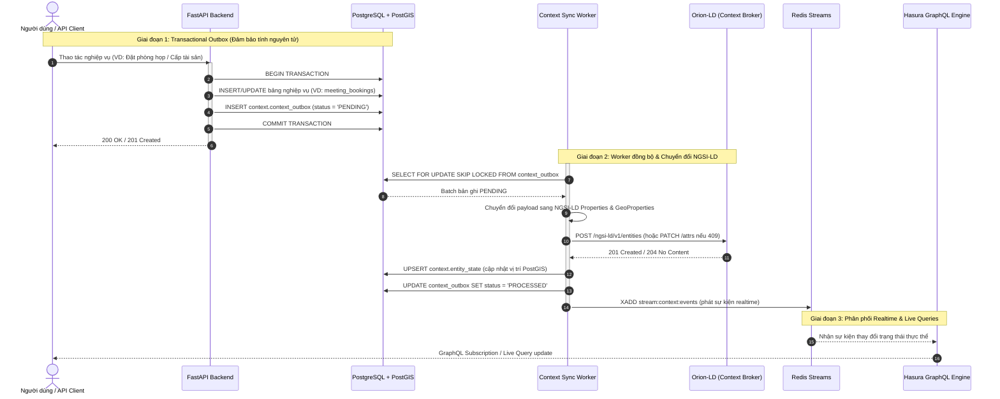
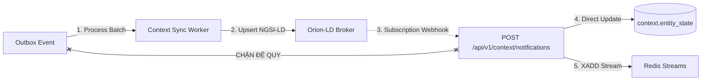

# Sơ đồ Kiến trúc Tổng thể & Thiết kế Hệ thống (SAD)

Tài liệu này mô tả chi tiết Kiến trúc Tổng thể của toàn bộ hệ sinh thái **Proteus OS**, cũng như thiết kế kỹ thuật chuyên sâu của phân hệ lõi (Frontend & Backend).

---

## 1. Kiến trúc Tổng thể (Toàn hệ thống H-P-D-I)

Proteus OS sử dụng kiến trúc **Micro-Kernel (Nhân vi lõi) kết hợp với các Dịch vụ Độc lập (Microservices/Open-source tools)**. 

Thay vì tự xây dựng mọi thứ, phần lõi (Core Engine) đóng vai trò là "Bộ não điều phối" (Orchestrator) và "Cổng giao tiếp" (API Gateway), kết nối các công cụ nguồn mở tốt nhất thế giới lại với nhau.

```mermaid
graph TD
    subgraph Frontend [Frontend: Launchpad & App Store]
        UI[Next.js App Shell]
    end

    subgraph CoreBackend [Backend: Core Engine]
        API[FastAPI Gateway]
        Orch[AI Orchestrator]
        PluginMgr[Plugin Manager]
    end

    subgraph OpenSourceEcosystem [Các Không gian H-P-D-I]
        Keycloak[(Keycloak - Identity)]
        Mattermost[Mattermost - Chat]
        n8n[n8n - Workflow]
        Metabase[Metabase - BI]
        PG[(PostgreSQL)]
        Qdrant[(Qdrant - Vector DB)]
        Appsmith[Appsmith - Lowcode UI]
        EventBus[[Redis Pub/Sub - Event Bus]]
    end

    User((Người dùng)) --> UI
    UI --> Keycloak : 1. Đăng nhập SSO
    UI --> API : 2. Giao tiếp API (JWT)
    API --> Keycloak : 3. Xác thực Token
    
    API --> PluginMgr
    PluginMgr --> PG : Khởi tạo Bảng dữ liệu
    PluginMgr --> n8n : Nạp luồng Quy trình
    PluginMgr --> Metabase : Tạo Dashboard
    
    API --> Orch
    Orch --> Qdrant : RAG (Truy xuất Tri thức)
    Orch --> n8n : Kích hoạt Hành động (Agent)
    Orch --> Mattermost : Gửi tin nhắn Phê duyệt
    n8n <--> EventBus : Pub/Sub Giao tiếp chéo Plugin
    API --> EventBus : Bắn sự kiện

    Appsmith -.-> UI : Nhúng qua Iframe
    Metabase -.-> UI : Nhúng qua Iframe
```

---

## 2. Kiến trúc Lõi (Core Engine Architecture)

Phần lõi do đội ngũ tự phát triển (Innovation Layer) được chia làm 2 thành phần độc lập: Frontend và Backend.

### 2.1. Frontend Architecture (Next.js)
Frontend sử dụng Next.js (React) với kiến trúc **BFF (Backend-for-Frontend)** để tối ưu hóa bảo mật và tốc độ.

```mermaid
graph LR
    subgraph Browser [Client Browser]
        React[React Client Components]
        Zustand[State Management]
    end
    
    subgraph FrontendServer [Next.js Server]
        SSR[Server-Side Rendering]
        NextAPI[Next API Routes / Proxy]
    end
    
    subgraph BackendServer [FastAPI Server]
        FastAPI[Core REST API]
    end

    React <--> NextAPI : Gọi API
    React <--> SSR : Hydration (Tải giao diện nhanh)
    NextAPI <--> FastAPI : Giao tiếp nội mạng (An toàn)
```

**Đặc điểm kỹ thuật Frontend:**
- **App Shell Design:** Tạo ra một khung viền giao diện duy nhất. Các ứng dụng khác (Appsmith, Metabase, Mattermost) được nhúng vào vị trí nội dung (Main Content Area) để giữ lại thanh điều hướng (Navbar) của Proteus OS. Để khắc phục lỗi SameSite Cookie và X-Frame-Options khi nhúng Iframe, hệ thống sử dụng **Single-Domain Path-Based Routing** qua Traefik (tất cả các app chạy chung một domain gốc, vd: `proteus.local/chat`, `proteus.local/apps`).
- **BFF Pattern & Token Storage:** Client (Trình duyệt) không bao giờ gọi trực tiếp xuống FastAPI. Mọi request đi qua Next.js API Routes (BFF). Sau khi Keycloak trả về Access Token, **Next.js Server** (không phải browser) lưu Token vào **HttpOnly, Secure, SameSite=Strict Cookie**. Token không bao giờ xuất hiện ở JavaScript client, giúp chống lại tấn công XSS. Khi cần gọi FastAPI, Next.js API Route đọc Token từ Cookie phía server và đính kèm vào `Authorization: Bearer` Header trước khi forward request.
- **Zustand — Chỉ dùng cho UI State:** Zustand chỉ lưu trữ các trạng thái UI không nhạy cảm như: trạng thái sidebar (mở/đóng), theme (dark/light), ngôn ngữ hiển thị. **Tuyệt đối không lưu JWT Token, user credentials, hay bất kỳ thông tin nhạy cảm nào vào Zustand.**
- **Kiến trúc Custom Hooks & Zustand (Thay thế MVVM):** Thay vì áp dụng mô hình MVVM truyền thống (vốn đi ngược lại triết lý One-way Data Flow của React), Frontend sử dụng mô hình Component-Based kết hợp Custom Hooks.
  - *ViewModel (Custom Hooks):* Đóng gói toàn bộ Business Logic và State Management (sử dụng **Zustand**) vào các hooks như `useAppStore()`, `useAuth()`. Điều này giúp tách biệt hoàn toàn giao diện khỏi logic nghiệp vụ, dễ dàng viết Unit Test.

### 2.1.1. Luồng Xác thực SSO & Nhúng Iframe (Sequence Diagram)
Việc truyền Token vào Iframe (Appsmith/Metabase) một cách bảo mật thường vấp phải giới hạn SameSite Cookie hoặc CORS. Để khắc phục, hệ thống định tuyến Iframe đi qua Traefik Proxy và tận dụng cơ chế **HttpOnly Cookie chia sẻ cùng domain**.

> [!WARNING]
> **Anti-pattern cần tránh:** Tuyệt đối **KHÔNG** truyền JWT Token vào URL query parameter (VD: `?token=xxx`). Token trong URL sẽ bị lộ trong: browser history, server access log, `Referer` header khi click link, và màn hình shoulder-surfing. Đây là vi phạm nghiêm trọng OWASP A02:2021.

```mermaid
sequenceDiagram
    participant User as Người dùng
    participant Browser as Browser (Client)
    participant NextJS as Next.js Server (BFF)
    participant Keycloak as Keycloak (SSO)
    participant Traefik as Traefik Proxy
    participant Appsmith as Appsmith (Iframe)

    User->>Browser: Truy cập ứng dụng (VD: proteus.local/apps/hr)
    Browser->>NextJS: GET /apps/hr (chưa có session)
    NextJS->>Keycloak: Redirect đăng nhập (OIDC Authorization Code Flow)
    User->>Keycloak: Nhập username/password
    Keycloak-->>NextJS: Callback với Authorization Code
    NextJS->>Keycloak: Đổi Code lấy Access Token + Refresh Token
    Note over NextJS,Keycloak: Bước này xảy ra phía SERVER, browser không thấy Token
    NextJS->>Browser: Set-Cookie: session=<encrypted_token>; HttpOnly; Secure; SameSite=Strict
    Browser->>NextJS: GET /proxy/appsmith (tự động kèm HttpOnly Cookie)
    NextJS->>NextJS: Đọc Token từ Cookie (phía server), gắn vào Authorization Header
    NextJS->>Traefik: Forward request kèm Bearer Token (nội mạng)
    Note over NextJS,Traefik: Single-Domain Path-Based Routing (cùng domain proteus.local)
    Traefik->>Appsmith: Chuyển tiếp Request nội mạng (Kèm Session/Auth)
    Appsmith-->>Browser: Render HTML (Đã đăng nhập thành công)
    Browser-->>User: Hiển thị giao diện liền mạch
```

### 2.2. Backend Architecture (FastAPI)
Backend sử dụng **FastAPI (Python)**, được thiết kế theo mô hình **Hexagonal Architecture (Ports and Adapters)** kết hợp với **Domain-Driven Design (DDD)**. 

Bởi vì Core Engine đóng vai trò là một "Orchestrator" phải gọi rất nhiều công cụ bên ngoài (n8n, Metabase, Keycloak, Qdrant), kiến trúc Hexagonal giúp giữ cho lõi nghiệp vụ hoàn toàn độc lập với các thư viện và framework bên ngoài.

**Cấu trúc các lớp (Layers):**
1. **Primary Adapters (Inbound):** 
   - *API Routers:* Nhận REST request từ Frontend BFF, validate bằng Pydantic.
   - *Middleware/Auth Layer:* Xác minh JWT Token từ Keycloak, trích xuất `tenant_id` và `roles`.
2. **Core Domain (Nghiệp vụ cốt lõi):**
   - *Plugin Use Cases:* Xử lý logic cài đặt/gỡ bỏ plugin.
   - *AI Orchestrator Use Cases:* Phân tích ngữ nghĩa lệnh AI, lên kế hoạch thực thi (ReAct pattern).
3. **Secondary Ports (Outbound Interfaces):** Định nghĩa các Abstract Base Classes (Interface) mà Domain cần dùng (VD: `IWorkflowEngine`, `IIdentityServer`).
4. **Secondary Adapters (Outbound):** Triển khai thực tế các Ports.
   - `N8nAdapter`: Gọi API n8n để nạp luồng.
   - `MetabaseAdapter`: Gọi API Metabase để tạo Dashboard.
   - `QdrantAdapter`: Giao tiếp với Vector DB.
   - `PostgresAdapter`: Tương tác DB thông qua SQLAlchemy (có RLS).
*(Kiến trúc này giúp dự án dễ dàng thay thế công cụ, ví dụ đổi từ Qdrant sang Milvus chỉ bằng cách viết một Adapter mới).*

---

## 2.3. AI Orchestrator & DX-DSL

AI trong Proteus OS hoạt động theo **3 chế độ độc lập**:

| Chế độ | Component | Mô tả |
|---|---|---|
| **RAG Assistant** | LLM Provider (httpx) + Qdrant | Trả lời câu hỏi dựa trên tài liệu nội bộ. Không yêu cầu phê duyệt |
| **Proactive Monitor** | Cron Job + n8n | Chạy ngầm 24/7, quét dữ liệu, phát hiện bất thường, gửi cảnh báo Mattermost. Chỉ báo cáo, không tự hành động |
| **Executive Agent** | Orchestrator + DX-DSL | Nhận lệnh ngôn ngữ tự nhiên, dịch sang DX-DSL, chờ phê duyệt, rồi thực thi |

**Luồng thực thi (Executive Agent):** Nhận lệnh → LLM Provider phân tích → tạo **DX-DSL Command** → Orchestrator xác thực quyền + action whitelist → gửi Interactive Message Mattermost (Human-in-the-loop) → người dùng bấm [Phê duyệt] → Orchestrator gọi n8n API thực thi.

Cấu trúc DSL chuẩn và danh sách action types được phép xem tại: **[`docs/dsl-spec.md`](./dsl-spec.md)**.

**Nguyên tắc Human-in-the-loop bắt buộc:** Bất kỳ DSL Command nào có `effect: write` hoặc `effect: critical` đều **PHẢI** gửi Interactive Message qua Mattermost để chờ phê duyệt của Ban Giám đốc trước khi thực thi. AI không được phép tự động bypass bước này.

**Hard Limits (cứng, không cài đặt được):** AI chỉ thực thi các action nằm trong DX-DSL whitelist. Mọi yêu cầu ngoài danh sách (đặc biệt là `core.data.delete_all`, truy cập cross-tenant, sửa code) sẽ bị từ chối ngay tại tầng Orchestrator với lỗi `DSL_INVALID_ACTION`. Chi tiết đầy đủ xem tại **[`docs/clarification.md §9`](./clarification.md)**.

### Phân công rõ ràng: n8n vs. LLM Provider (FastAPI)

> [!IMPORTANT]
> **n8n là "bàn tay" (execution). LLM Provider là "bộ não" (reasoning).** Hai thứ không thay thế nhau được.

| Chế độ AI | n8n làm gì | LLM Provider (FastAPI) làm gì |
|---|---|---|
| **RAG Assistant** | ❌ Không tham gia | ✅ Toàn bộ: embed query → Qdrant Hybrid Search → prompt → LLM → trả về |
| **Proactive Monitor** | ✅ Toàn bộ: Cron trigger → PostgreSQL query → evaluate → Mattermost alert | ❌ Không tham gia |
| **Executive Agent** | ✅ Nửa sau: nhận webhook từ FastAPI → thực thi hành động → callback | ✅ Nửa trước: hiểu ngôn ngữ tự nhiên → tạo DX-DSL → validate RBAC → quản lý Human-in-the-loop wait state |

**Tại sao không dùng n8n AI Nodes thay LLM Provider hoàn toàn?**

n8n có tích hợp AI Agent nodes, nhưng **không đủ cho production** vì:
- Không hỗ trợ Qdrant Hybrid Search (Dense Vector + BM25) — cần cho tiếng Việt
- Không thể inject `tenant_id` vào RAG context một cách type-safe
- Không có Pydantic schema validation cho DX-DSL output
- Khó custom prompt & trace so với API gọi trực tiếp qua httpx
- Streaming response cho chat UI không hỗ trợ tốt

**Tóm lại:** Mọi logic cần **LLM reasoning** → FastAPI + LLM Provider. Mọi logic cần **workflow automation** (cron, webhook, DB write, gửi thông báo) → n8n.

---

## 3. Kiến trúc Đa khách hàng (Multi-Tenancy) & Phân quyền

Để Proteus OS có thể thương mại hoá dưới dạng SaaS bán cho nhiều tổ chức (trường học/doanh nghiệp) dùng chung trên 1 hệ thống đám mây, kiến trúc bảo mật được thiết kế như sau:

- **Cô lập Tài khoản (Keycloak Realms):** Sử dụng tính năng **Realms** của Keycloak. Mỗi khách hàng (Trường A, Doanh nghiệp B) là một Realm độc lập. Người dùng của Trường A không bao giờ đăng nhập chéo được vào Trường B.
- **Phân quyền Động (RBAC — 3 tầng):** Hệ thống có 3 tầng phân quyền rõ ràng:
  - **Platform Level** (`superadmin`, `platform_support`): ICTU Team, có quyền quản lý tất cả Tenant và Marketplace.
  - **Tenant Level** (`tenant_admin`): Admin của từng tổ chức, có quyền cài/gỡ Plugin và phân quyền người dùng **trong phạm vi Tenant của mình**.
  - **Plugin Level** (`hr_manager`, `leave_approver`, v.v.): Role được tạo tự động khi Plugin cài đặt, định nghĩa trong `manifest.yaml`. Người dùng chỉ thao tác nghiệp vụ, **không có quyền quản lý Plugin**.
  
  Token JWT mang theo Role → Frontend đọc để render Dynamic UI (giấu/hiện tính năng) → Backend đọc để enforce RBAC. Chi tiết xem tại [`docs/clarification.md §7`](./clarification.md).
- **Cô lập Dữ liệu (PostgreSQL Row-Level Security):** Toàn bộ dữ liệu nghiệp vụ của các tổ chức được lưu chung trên một Database (Shared-Schema) để tối ưu hóa tài nguyên và dễ dàng bảo trì. Hệ thống sử dụng cơ chế **Row-Level Security (RLS)** trên Postgres (thông qua cột `tenant_id`) để đảm bảo dữ liệu của tổ chức nào chỉ tổ chức đó truy cập được, an toàn tuyệt đối ở cấp độ cơ sở dữ liệu.
- **Cô lập Ứng dụng (App Store):** Trường A có thể mua và cài Plugin "Quản lý Canteen", hệ thống sẽ kích hoạt Plugin này vào Schema của Trường A. Trường B sẽ không nhìn thấy tính năng này nếu chưa mua.

---

## 4. Quyết định Kiến trúc (Architecture Decision Records)

### ADR-001: Chọn Redis làm Event Bus

**Ngày quyết định:** 2026-08-05  
**Trạng thái:** Đã chốt ✅

**Lý do lựa chọn Redis Pub/Sub thay vì RabbitMQ:**

| Tiêu chí | Redis Pub/Sub | RabbitMQ |
|---|---|---|  
| **RAM footprint** | ~50MB | ~200MB+ |
| **Độ phức tạp** | Đơn giản, ít config | Phức tạp, cần nhiều config |
| **Message durability** | Mất message nếu subscriber offline | Persistent, có ACK |
| **Phù hợp với use case** | Event-driven thông báo tức thì | Reliable task queue |

**Kết luận:** Trong Proteus OS, Event Bus chủ yếu dùng để **Plugin A phát sự kiện, Plugin B lắng nghe tức thì** (VD: HR tạo nhân viên mới → Finance tạo tài khoản lương). Đây là use case của fire-and-forget notification, không yêu cầu message durability. Redis Pub/Sub đủ dùng và nhẹ hơn nhiều so với RabbitMQ, giúp giảm yêu cầu RAM của toàn hệ thống.

**Lưu ý:** Nếu trong tương lai cần **reliable task queue** (VD: email gửi đi phải đảm bảo không mất), sẽ thêm **Redis Streams** (không phải Pub/Sub) hoặc nâng cấp lên RabbitMQ cho queue đó riêng biệt.

---

### ADR-002: Không dùng Graph RAG ở giai đoạn hiện tại

**Ngày quyết định:** 2026-08-05  
**Trạng thái:** Đã chốt ✅ — Xem xét lại ở v2.0

#### Vấn đề đặt ra

Liệu có nên dùng **Graph RAG** (Microsoft GraphRAG / LlamaIndex Knowledge Graph) thay cho Vector RAG thuần túy (Qdrant) để cải thiện chất lượng trả lời của AI?

#### Graph RAG là gì?

Standard Vector RAG trích xuất chunk văn bản → embed → lưu Qdrant → tìm kiếm cosine similarity.

Graph RAG bổ sung thêm bước: trích xuất **thực thể (Entity)** và **quan hệ (Relationship)** từ văn bản → xây dựng **Knowledge Graph** → khi query, kết hợp graph traversal + vector search để tìm câu trả lời đa bước (multi-hop reasoning).

```
Standard RAG:  Tài liệu → Chunks → Qdrant (Vector)
                                         ↓
                              Query → cosine similarity → LLM answer

Graph RAG:     Tài liệu → Entity/Relation Extraction → Knowledge Graph (Neo4j)
                       ↘ Chunks → Qdrant (Vector)
                                         ↓
                              Query → Graph Traversal + Vector Search → LLM answer
```

#### Phân tích cho Proteus OS

| Câu hỏi thực tế | Cách xử lý tốt nhất | Cần Graph RAG? |
|---|---|---|
| "Quy trình nghỉ phép là gì?" | Vector RAG tìm trong tài liệu HR Policy | ❌ Không |
| "Hôm nay có bao nhiêu người nghỉ?" | SQL query vào `hr_leave_requests` | ❌ Không |
| "Ai là quản lý của phòng Kế toán?" | SQL query vào `hr_employees` | ❌ Không |
| "Đơn hàng #1024 kẹt ở đâu, tại sao?" | SQL + n8n workflow metadata | ❌ Không |
| "Nhân viên nào vừa được phê duyệt nghỉ và chưa bàn giao?" | SQL JOIN query | ❌ Không |
| "Quy trình phê duyệt hóa đơn liên quan đến những ai?" | Vector RAG tìm SOP document | ⚠️ Có thể |

**Nhận xét:** ~90% câu hỏi trong Proteus OS rơi vào 2 loại: (1) query có cấu trúc từ PostgreSQL, (2) tìm kiếm text từ SOP/chính sách. Cả hai đều được giải quyết bởi SQL + Standard Vector RAG mà **không cần Graph RAG**.

#### Lý do từ chối ở giai đoạn hiện tại

| Rủi ro | Chi tiết |
|---|---|
| **Chi phí LLM index cao** | Microsoft GraphRAG phải gọi LLM hàng ngàn lần khi indexing để tóm tắt cộng đồng (community summarization). Một corpus 1000 tài liệu có thể tốn hàng trăm USD chỉ để index. |
| **Hạ tầng phức tạp** | Yêu cầu thêm Neo4j (hoặc NetworkX) cùng với Qdrant. Tăng gánh nặng vận hành và chi phí RAM. |
| **Entity extraction không hoàn hảo** | Trích xuất thực thể từ văn bản tiếng Việt chuyên ngành (HR/Finance) yêu cầu fine-tuning hoặc prompt engineering nặng — rủi ro chất lượng thấp. |
| **Over-engineering** | Vấn đề của hệ thống hiện tại chưa đủ phức tạp để cần đến Graph RAG. Dữ liệu quan hệ đã có trong PostgreSQL với schema rõ ràng. |
| **Maintenance cost** | Knowledge graph cần được cập nhật mỗi khi tài liệu thay đổi — phức tạp hơn nhiều so với re-embedding chunk thuần túy. |

#### Quyết định: Hybrid Search (Qdrant) đủ dùng

Thay vì Graph RAG, cải thiện chất lượng RAG bằng **Hybrid Search** (đã có sẵn trong Qdrant):

```
Query của người dùng
      ↓
┌──────────────────────────────────────────┐
│  Hybrid Search (Qdrant)                  │
│  ┌─────────────────┐ ┌─────────────────┐ │
│  │ Dense Vector    │ │ Sparse BM25     │ │
│  │ (Semantic)      │ │ (Keyword)       │ │
│  └─────────────────┘ └─────────────────┘ │
│         ↓ RRF Fusion (Reciprocal Rank)   │
└──────────────────────────────────────────┘
      ↓
Top-k chunks → LLM answer
```

Hybrid Search kết hợp **tìm kiếm ngữ nghĩa** (dense vector) + **tìm kiếm từ khóa** (BM25) → cải thiện đáng kể độ chính xác, đặc biệt với tên riêng tiếng Việt (mã nhân viên, tên phòng ban, v.v.) mà dense-only thường bỏ sót.

#### Điều kiện để xem xét lại Graph RAG (v2.0)

Graph RAG nên được xem xét **nếu và chỉ nếu** xuất hiện các vấn đề sau sau khi go-live:

1. Người dùng thường xuyên hỏi câu hỏi multi-hop mà SQL + Vector RAG không trả lời tốt (VD: "Tìm tất cả nhân viên báo cáo cho X, mà đang phụ trách dự án Y, và có đơn Z chưa xử lý").
2. Corpus tài liệu tăng lên > 10,000 documents và chất lượng retrieval xuống rõ ràng.
3. Có resource đủ để dùng LlamaIndex Knowledge Graph RAG (nhẹ hơn Microsoft GraphRAG, không cần community summarization).

---

### ADR-003: Lựa chọn Backend lưu trữ Context Broker (Orion-LD Backing Store)

**Ngày quyết định:** 2026-11-22  
**Trạng thái:** Đã chốt ✅ (Lớp 3 — Sprint 1)

#### Vấn đề đặt ra
FIWARE Orion-LD đóng vai trò là Context Broker trung tâm cho Lớp 3 (Quản lý Thực thể & Digital Twin) theo chuẩn quốc tế ETSI NGSI-LD. Orion-LD yêu cầu một Document Database làm backing store để lưu trữ các thực thể JSON-LD, GeoJSON, và thông tin tiến hóa thời gian (temporal evolution). Cần chọn giải pháp cân bằng giữa tiêu chuẩn FIWARE và NFR1 (tuân thủ Open Source License OSI-approved).

#### So sánh các phương án

| Tiêu chí | Phương án A: MongoDB 6.0/7.0 (Khuyến nghị FIWARE) | Phương án B: FerretDB + PostgreSQL (Apache-2.0) | Phương án C: Scorpio / Stellio (PostgreSQL) |
|---|---|---|---|
| **Giấy phép (License)** | SSPL (Server Side Public License — không thuộc OSI) | Apache-2.0 (100% OSI-approved) | BSD-3-Clause / Apache-2.0 |
| **Độ tương thích Orion-LD** | 100% (Reference Implementation chính thức của FIWARE) | Tương thích giao thức MongoDB wire, một số aggregation/cursor nâng cao bị hạn chế | Độc lập, không chạy Orion-LD (thay thế broker) |
| **Hỗ trợ Geo & Spatial** | 2dsphere index gốc mạnh mẽ | Dựa vào PostGIS backend | Hỗ trợ PostGIS |
| **Mức chiếm dụng RAM** | ~300MB - 512MB RAM | Thêm một proxy container (~80MB) + PostgreSQL hiện tại | Đòi hỏi Java/Spring Boot (~1.5GB RAM) |
| **Vận hành & Backup** | Đơn giản (`mongodump`, `mongorestore`) | Dùng chung PostgreSQL backup | Vận hành phức tạp hơn nhiều |

#### Quyết định kiến trúc
1. **Sử dụng MongoDB 6.0 làm backing store mặc định cho Orion-LD** trong môi trường Docker Compose tiêu chuẩn. Container MongoDB được cô lập hoàn toàn trong mạng nội bộ `proteus-net`, không expose port ra ngoài Internet, đảm bảo an toàn tuyệt đối và tuân thủ các điều khoản sử dụng nội bộ của SSPL.
2. **Thiết kế cấu hình trừu tượng qua biến môi trường `MONGO_URL`**: Cho phép các tổ chức yêu cầu khắt khe về 100% giấy phép OSI kích hoạt **FerretDB** thay thế làm drop-in replacement mà không cần sửa đổi bất kỳ mã nguồn hay cấu trúc gọi API nào của Orion-LD.
3. **Giới hạn tài nguyên:** Đặt giới hạn `mem_limit: 512m` cho container Mongo trong `deploy/docker-compose.yml` để bảo toàn RAM cho các dịch vụ khác.

---

### ADR-004: Chiến lược Hasura GraphQL và Phân tách Tenant (Schema Context + RLS)

**Ngày quyết định:** 2026-11-22  
**Trạng thái:** Đã chốt ✅ (Lớp 3 — Sprint 1)

#### Vấn đề đặt ra
Proteus OS áp dụng mô hình Multi-Tenancy cô lập cao: các bảng Core và bảng nghiệp vụ plugin sử dụng schema phân tách (`tenant_<uuid>`) hoặc bảng dùng chung có cột `tenant_id` bảo vệ bởi Row-Level Security (RLS). Khi tích hợp Hasura GraphQL Engine để cung cấp live queries và Digital Twin API, việc dynamic track hàng trăm schema-per-tenant sẽ làm Hasura metadata phình to, làm chậm thời gian khởi động và gây khó khăn khi quản lý vòng đời tenant.

#### Quyết định kiến trúc
1. **Schema `context` tập trung kết hợp RLS:**
   - Toàn bộ thực thể Digital Twin, Outbox, và Trạng thái Thực thể dùng chung một schema chuyên dụng `context` (gồm các bảng `entity_state`, `context_outbox`, `sync_cursor`, `subscriptions`).
   - Mọi bảng trong schema `context` bắt buộc có cột `tenant_id UUID NOT NULL` và được kích hoạt PostgreSQL **FORCE ROW LEVEL SECURITY**.
2. **Hasura JWT Claims & Session Variables:**
   - Hasura nhận JWT Token từ Keycloak (hoặc qua Webhook Mode). Keycloak Mapper sẽ đính kèm thông tin:
     - `x-hasura-default-role`: Vai trò mặc định của user (`staff`, `tenant_admin`, `superadmin`).
     - `x-hasura-allowed-roles`: Danh sách các vai trò được cấp phép.
     - `x-hasura-tenant-id`: UUID của tenant đang đăng nhập.
     - `x-hasura-user-id`: UUID của người dùng.
3. **Cơ chế áp dụng RLS Policy hai chiều:**
   - Khi truy vấn qua FastAPI backend: Sử dụng session setting `app.current_tenant_id`.
   - Khi truy vấn qua Hasura: Sử dụng session setting `current_setting('hasura.user', true)::json->>'x-hasura-tenant-id'`.
   - Policy: `tenant_id = COALESCE(NULLIF(current_setting('app.current_tenant_id', true), '')::uuid, (NULLIF(current_setting('hasura.user', true), '')::json->>'x-hasura-tenant-id')::uuid)`.
4. **Phân tách trách nhiệm:**
   - Hasura chỉ expose dữ liệu **Read/Subscribe** (Live Queries, Digital Twin view, metrics).
   - Mọi thao tác Mutation ghi dữ liệu nghiệp vụ quan trọng **bắt buộc đi qua FastAPI Backend** để thực thi Business Invariants, kiểm tra RBAC và ghi audit log.
   - Các bảng plugin nội bộ chứa dữ liệu nhạy cảm được bảo vệ thông qua Database Views lọc cột trước khi track vào Hasura.

---

### ADR-005: Transactional Outbox và Redis Streams cho Đồng bộ Ngữ cảnh Thực thể

**Ngày quyết định:** 2026-11-22  
**Trạng thái:** Đã chốt ✅ (Lớp 3 — Sprint 1)

#### Vấn đề đặt ra
Hệ thống cần đồng bộ dữ liệu thay đổi từ các phân hệ nghiệp vụ (PostgreSQL) sang Context Broker (Orion-LD) và Hasura GraphQL Realtime. Nếu dùng cơ chế gọi API đồng bộ trực tiếp (dual-write), khi xảy ra sự cố mạng hoặc service đích tạm thời gián đoạn, dữ liệu sẽ rơi vào trạng thái bất nhất (inconsistent state). Ngược lại, nếu chỉ dùng Redis Pub/Sub hiện tại (ADR-001), các tin nhắn sẽ bị mất khi consumer đang khởi động lại hoặc gặp sự cố.

#### Quyết định kiến trúc
1. **Mô hình Transactional Outbox Pattern:**
   - Khi có thay đổi dữ liệu nghiệp vụ (INSERT/UPDATE/DELETE), một sự kiện outbox sẽ được ghi vào bảng `context.context_outbox` trong **cùng transaction cơ sở dữ liệu** với nghiệp vụ chính. Nếu nghiệp vụ thất bại (rollback), sự kiện outbox cũng tự động hủy.
   - Bảng `context_outbox` lưu trữ: `id`, `tenant_id`, `entity_type`, `entity_id`, `op` (CREATE/UPDATE/DELETE), `payload` (JSONB), `status` (`PENDING`, `PROCESSING`, `PROCESSED`, `FAILED`), `retry_count`, `idempotency_key`, `created_at`.
2. **Worker xử lý nền (`context-sync-worker`):**
   - Chạy vòng lặp worker đọc các bản ghi `PENDING` theo cơ chế hàng đợi cạnh tranh an toàn:
     ```sql
     SELECT id, tenant_id, entity_type, entity_id, op, payload 
     FROM context.context_outbox 
     WHERE status = 'PENDING' 
     ORDER BY created_at ASC 
     LIMIT 50 
     FOR UPDATE SKIP LOCKED;
     ```
   - Chuyển đổi payload sang định dạng chuẩn NGSI-LD và đồng bộ sang Orion-LD.
   - Khi đồng bộ thành công, đánh dấu `PROCESSED` và phát sự kiện vào **Redis Streams** (`stream:context:events`).
3. **Idempotency & Dead-Letter Queue (DLQ):**
   - Khóa duy nhất idempotency: `idempotency_key = sha256(tenant_id + ':' + entity_id + ':' + str(version/timestamp))`.
   - Áp dụng Exponential Backoff khi gặp lỗi (1s, 2s, 4s, 8s, 16s).
   - Nếu thử lại quá 5 lần vẫn thất bại, sự kiện được chuyển sang trạng thái `FAILED` (Dead-Letter Queue) kèm thông báo cảnh báo giám sát, không làm nghẽn luồng xử lý các sự kiện khác.
4. **Cam kết độ tin cậy:** Đạt chuẩn **At-least-once delivery** và xử lý **Idempotent** tại tất cả các điểm nhận tin.

---

## 4. Kiến trúc Chi tiết Lớp 3 (Context Broker, Digital Twin & Realtime Dataflow)

Lớp 3 kết nối dữ liệu vận hành từ các phân hệ plugin thành mô hình **Bản sao số (Digital Twin)** thời gian thực, tuân thủ chuẩn mở quốc tế **ETSI NGSI-LD** và hỗ trợ truy vấn không gian qua **PostGIS**.

### 4.1. Sơ đồ Luồng Đồng bộ Dữ liệu (Sequence Diagram)



### 4.2. Cơ chế Chống Vòng lặp Đồng bộ (Anti-Sync Loop)



- Endpoint `/api/v1/context/notifications` chỉ cập nhật vào bảng cache `context.entity_state` và Redis stream, **tuyệt đối không ghi vào bảng outbox**, triệt tiêu hoàn toàn khả năng lặp vô hạn.


